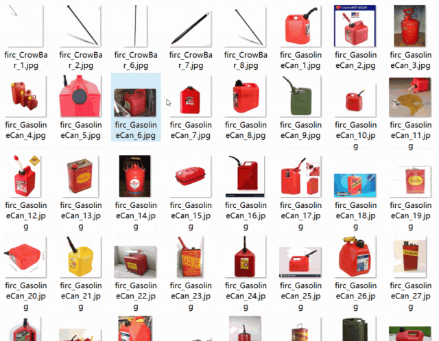
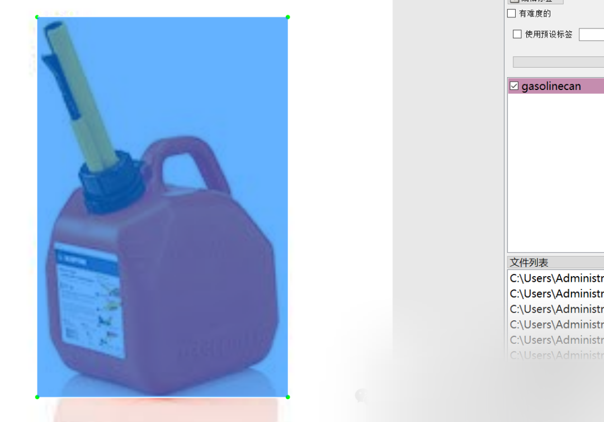

# [Dataset] Object Detection - Mechanical Common Tools Detection VOC+YOLO format, 4713 images in 8 categories

Dataset format: Pascal VOC format + YOLO format (txt file without split path, only containing jpg images and corresponding VOC format xml files and YOLO format txt files)
Number of images (jpg file count): 4713
Number of annotations (xml file count): 4713
Number of annotations (txt file count): 4713
Number of annotation categories: 8
Annotation category names: ["crowbar", "gasolinecan", "hammer", "pliers", "rope", "screwdriver", "toolbox", "wrench"]
Number of boxes per category:
crowbar boxes = 5
gasolinecan boxes = 287
hammer boxes = 1955
pliers boxes = 195
rope boxes = 375
screwdriver boxes = 2164
toolbox boxes = 353
wrench boxes = 1628
Total number of boxes: 6962
Using labelImg for annotation
Annotation rules: Draw a box around the category
Important note: No guarantee is made regarding the accuracy or weights of the trained models using this dataset. The dataset provides accurate and reasonable annotations only.

Image overview:

Annotation example:

## Payment

Here is a pay link on Stripe ( https://buy.stripe.com/3cs8yP7sY87d0vu9AB ). Please contact me lonlonago@foxmail.com after funding $89, and I will send you a complete data files , thank you!

